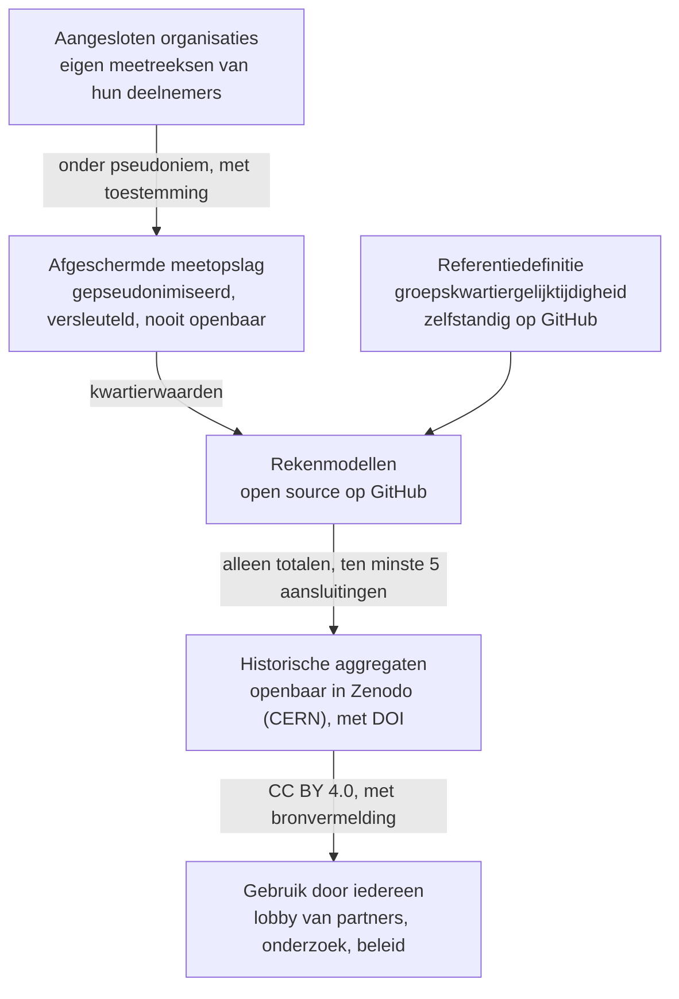

# Open Meetnet Energiedelen

Open Meetnet Energiedelen meet hoe goed opwek en verbruik van huishoudens per kwartier samenvallen, en maakt de uitkomsten openbaar als publiek goed. Daarmee krijgen burgers, energiegemeenschappen en beleidsmakers voor het eerst een onafhankelijk en controleerbaar ijkpunt voor de vraag hoeveel stroom buren samen kunnen benutten, en hoeveel daarvan de huidige regels laten liggen. Het project is open, onafhankelijk en van zijn deelnemers.

> *Open Meetnet Energiedelen* is een werknaam.

## Inhoud

- [Het vraagstuk: gelijktijdigheid](#het-vraagstuk-gelijktijdigheid)
- [Doelen](#doelen)
- [Plaats in de energietransitie](#plaats-in-de-energietransitie)
- [Noodzaak: waarom open en onafhankelijk](#noodzaak-waarom-open-en-onafhankelijk)
- [Inrichting](#inrichting)
- [Groeipad](#groeipad)
- [Meedoen](#meedoen)
- [Licenties](#licenties)
- [Bronnen](#bronnen)

## Het vraagstuk: gelijktijdigheid

De energietransitie loopt steeds vaker niet vast op het opwekken van stroom, maar op het moment waarop die stroom er is. Zonnepanelen leveren rond het middaguur; huishoudens verbruiken vooral in de ochtend en avond. Wat niet tegelijk wordt gebruikt, gaat het net op, terwijl dat net op steeds meer plaatsen vol raakt.

Voor huishoudens met zonnepanelen telt dat moment vanaf 1 januari 2027 ook financieel, nu de salderingsregeling stopt. Stroom die zij op hetzelfde kwartier zelf of met hun buren gebruiken, is dan meer waard dan stroom die zij terugleveren.

Energiedelen binnen een groep kan dat verschil overbruggen: het overschot van het ene huis dekt het verbruik van het andere, in hetzelfde kwartier. Hoeveel dat oplevert, hangt af van de **groepskwartiergelijktijdigheid**: het deel van de opwek in een groep dat in hetzelfde kwartier binnen die groep kan worden verbruikt.

Daarover bestaat in Nederland nauwelijks openbare, controleerbare kennis op basis van echte metingen. Dat geldt ook voor de vraag hoeveel van die gelijktijdigheid verloren gaat met een vaste verdeelsleutel, zoals de huidige regels die voorschrijven, in vergelijking met een verdeling achteraf naar werkelijk verbruik.

## Doelen

Het meetnet heeft vijf doelen, die op elkaar voortbouwen.

1. **Meten.** Echte meetreeksen per kwartier verzamelen van huishoudens en groepen in heel Nederland, met verschillende combinaties van zonnepanelen, batterijen, warmtepompen en elektrische auto's.
2. **IJken.** Een vaste, openbare referentiedefinitie van groepskwartiergelijktijdigheid aanbieden, zodat iedereen hetzelfde bedoelt en uitkomsten vergelijkbaar zijn.
3. **Rekenen.** Open rekenmodellen ontwikkelen die laten zien wat een groep kan delen met een vaste verdeelsleutel, met een dynamische verdeling achteraf, en met opslag of slimme sturing.
4. **Delen.** De uitkomsten als historische aggregaten openbaar maken, controleerbaar en duurzaam vindbaar, zodat iedereen ze kan gebruiken en controleren.
5. **Onderbouwen.** Burgers, energiegemeenschappen, gemeenten, netbeheerders en wetgevers een gezamenlijke feitenbasis geven voor keuzes over energiedelen, netgebruik en regelgeving.

## Plaats in de energietransitie

Gelijktijdigheid is op elke schaal hetzelfde vraagstuk: hoe meer stroom variabel wordt opgewekt, hoe belangrijker het wordt om die op het juiste moment dichtbij te gebruiken. Het meetnet begint in de straat, maar levert kennis die tot op mondiaal niveau bruikbaar is.

| Schaal | Wat er speelt | Wat het meetnet bijdraagt |
| --- | --- | --- |
| Lokaal | Buren en energiegemeenschappen willen stroom delen; wijken lopen tegen de grenzen van het net aan | Inzicht in welke groepen en combinaties van installaties het meest gelijktijdig zijn; onderbouwing voor eigen keuzes over verdeelsleutel, batterij of sturing |
| Regionaal | Dertig energieregio's werken met hun Regionale Energiestrategieën aan samen 35 TWh duurzame opwek op land in 2030; netcongestie verschilt per regio | Gegevens over hoeveel lokale opwek ook lokaal kan worden gebruikt, voor gemeenten, provincies en netbeheerders |
| Nationaal | Sinds 2026 mag energiedelen onder de Energiewet, met één leverancier en een vaste verdeelsleutel; een wetsvoorstel voor delen ongeacht leverancier ligt klaar; de salderingsregeling stopt per 1 januari 2027 | Onafhankelijk bewijs voor de uitwerking van de regels, met name de keuze tussen een vaste en een dynamische verdeling |
| Europees | De elektriciteitsrichtlijn geeft burgers sinds de wijziging van 2024 een recht op energiedelen (art. 15a); de hernieuwbare-energierichtlijn (RED III) mikt op ten minste 42,5% hernieuwbare energie in 2030 | Vergelijkbare cijfers met landen die al achteraf per kwartier verdelen, zoals België en Portugal; open publicatie volgens Europese praktijk voor open wetenschap |
| Mondiaal | Op COP28 (2023) spraken bijna 200 landen af het hernieuwbare vermogen in 2030 te verdrievoudigen; daarmee groeit het aandeel variabele opwek overal | Een open, herbruikbare methode en referentie die in elk land kan worden toegepast |

## Noodzaak: waarom open en onafhankelijk

Wie de gegevens heeft, bepaalt het gesprek. Daarom moet deze kennis open en onafhankelijk zijn.

- **Ongelijke informatie.** Netbeheerders en energieleveranciers beschikken over grote hoeveelheden meetgegevens, maar die zijn niet openbaar. Burgers en energiegemeenschappen praten mee over regels voor energiedelen zonder eigen feitenbasis.
- **Controleerbaarheid.** Beleid en investeringen over energiedelen moeten te controleren zijn. Dat kan alleen als methode, rekenmodellen en uitkomsten openbaar zijn en iedereen dezelfde berekening kan herhalen.
- **Vertrouwen.** Deelnemers stellen hun meetgegevens alleen beschikbaar als zij erop kunnen rekenen dat die worden beschermd, niet worden verkocht, en niet het merk of belang van één organisatie dienen.
- **Een gemeenschappelijk ijkpunt.** Zonder vaste definitie van groepskwartiergelijktijdigheid rekent ieder op zijn eigen manier, en zijn uitkomsten niet te vergelijken. Een onafhankelijke referentie lost dat op.
- **Tijd.** De Nederlandse regels voor energiedelen worden de komende jaren uitgewerkt. Wie nu begint met meten, heeft bewijs op het moment dat de keuzes worden gemaakt.

Onafhankelijkheid betekent hier niet afzijdigheid. Iedere organisatie mag meedoen, haar logo als partner tonen en de openbare uitkomsten gebruiken voor haar eigen belangen. Niemand krijgt eigendom van het meetnet of zeggenschap over de uitkomsten.

## Inrichting

Het meetnet is open waar dat kan en afgeschermd waar dat moet: alleen de ruwe meetreeksen zijn besloten, al het andere is publiek.

| Onderdeel | Waar | Toegang |
| --- | --- | --- |
| Referentiedefinitie groepskwartiergelijktijdigheid | GitHub, als zelfstandige opslagplaats | Openbaar; iedereen kan ernaar verwijzen |
| Rekenmodellen en dataspecificatie | GitHub, onder EUPL 1.2 | Openbaar; iedereen kan ze gebruiken en verbeteren |
| Meetreeksen van deelnemers | Afgeschermde opslag van het project, gepseudonimiseerd en versleuteld | Alleen de projectgroep; onderzoekers alleen met instemming van de partner en een overeenkomst |
| Methodiek, analyses en historische aggregaten | Zenodo, het open archief van CERN, met vaste verwijzing (DOI), onder CC BY 4.0 | Openbaar; vrij te gebruiken met bronvermelding, ook voor lobby |
| Website met partners | Website van het project | Openbaar; elke partner mag haar logo tonen |

**Uitgangspunten**

- **Open by design.** Methode, code en uitkomsten zijn vanaf het begin openbaar.
- **Privacy by design.** Deelnemers geven toestemming, gegevens zijn gepseudonimiseerd, en openbaar worden alleen totalen over ten minste vijf aansluitingen.
- **Neutraal.** Het project voert een eigen naam; partners zijn gelijkwaardig.
- **Federatief.** Iedere organisatie levert haar eigen meetreeksen aan en houdt de band met haar eigen deelnemers.
- **Duurzaam.** Publicatie in een permanent wetenschappelijk archief zorgt dat uitkomsten ook over jaren vindbaar en citeerbaar zijn.

## Groeipad

Het meetnet groeit van één straat naar een landelijke en Europees vergelijkbare dataset, in vier stappen. Elke stap gaat pas verder als de vorige werkt.

1. **Pilot.** De huidige groep van tien deelnemers, te gast bij een lokale energiecoöperatie. Toestemming en beveiliging op orde; eerste berekeningen met de referentiedefinitie.
   *Klaar als:* de referentiedefinitie en de eerste rekenmodellen openbaar op GitHub staan.
2. **Eerste partners.** Enkele andere organisaties leveren hun eigen meetreeksen aan via de partnerovereenkomst. De eerste historische aggregaten verschijnen in Zenodo.
   *Klaar als:* uitkomsten over meerdere groepen met verschillende samenstelling openbaar zijn.
3. **Landelijk.** Tientallen groepen in verschillende regio's. Het project verhuist naar een eigen stichting met een deelnemersraad en een partnerraad.
   *Klaar als:* de dataset de vergelijking tussen vaste en dynamische verdeling over een volledig jaar onderbouwt.
4. **Europees.** Uitwisseling met onderzoekers en meetinitiatieven in andere landen, met dezelfde open referentie.
   *Klaar als:* uitkomsten vergelijkbaar zijn met landen die al achteraf per kwartier verdelen.

In elke stap blijven de uitkomsten openbaar en bruikbaar voor iedereen, ook in de lobby van partners voor betere regels voor energiedelen.

## Meedoen

- **Als organisatie:** lever meetreeksen van je eigen deelnemers aan via de partnerovereenkomst. Je mag je logo als partner op de website zetten en de historische aggregaten gebruiken, ook in je eigen lobby.
- **Als ontwikkelaar of onderzoeker:** verbeter de rekenmodellen of de referentiedefinitie via een issue of pull request.
- **Contact:** [e-mailadres]

## Licenties

| Onderdeel | Licentie |
| --- | --- |
| Software en rekenmodellen | [EUPL 1.2](https://interoperable-europe.ec.europa.eu/collection/eupl/eupl-text-eupl-12) |
| Documentatie | [CC BY-SA 4.0](https://creativecommons.org/licenses/by-sa/4.0/deed.nl) |
| Historische aggregaten | [CC BY 4.0](https://creativecommons.org/licenses/by/4.0/deed.nl) |

## Bronnen

- [TNO via Binnenlands Bestuur: Energiedelen met wie je wilt (februari 2026)](https://www.binnenlandsbestuur.nl/ruimte-en-milieu/tno/energiedelen-met-wie-je-wilt)
- [Internetconsultatie wetsvoorstel implementatie EMD, energiedelen (november 2024)](https://internetconsultatie.nl/emdimplementatie/document/13264)
- [Omgevingsweb: 35 TWh duurzame energie op land in 2030 binnen bereik dankzij werk van regio's](https://www.omgevingsweb.nl/nieuws/35-twh-duurzame-energie-op-land-in-2030-binnen-bereik-dankzij-werk-van-regios/)
- [IRENA: UAE Consensus 2030, tripling renewables and doubling efficiency (oktober 2024)](https://www.irena.org/Publications/2024/Oct/UAE-Consensus-2030-tripling-renewables-doubling-efficiency)
- Richtlijn (EU) 2019/944, gewijzigd bij Richtlijn (EU) 2024/1711 (energiedelen, art. 15a); Richtlijn (EU) 2023/2413 (RED III)
